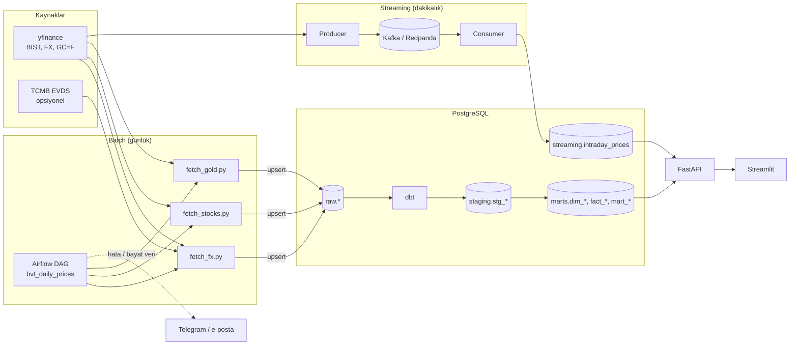

# Mimari (taslak)

## Katmanlar

| Şema | İçerik | Sahibi |
|---|---|---|
| `raw` | Kaynaktan geldiği gibi; doğal anahtar `(enstrüman, tarih, kaynak)` üzerinde idempotent upsert (`bvt.raw_loader`) | Python çekiciler |
| `staging` | Temizlenmiş, tipleri düzeltilmiş `stg_*` görünümleri | dbt |
| `marts` | Star schema + göstergeler, korelasyonlar | dbt |
| `streaming` | Dakikalık fiyatlar ve pencere ortalamaları | Kafka consumer |
| `ops` | `pipeline_runs` (çalışma kayıtları + tetikleyici), `data_gaps` (tatil / eksik gün raporu) | Python çekiciler, Airflow |

## Geçmiş yükleme ve boşluklar

- `bvt.backfill` aralığı 365 günlük parçalara böler, parçalar arasında bekler, her parçayı ayrı çalışma
  (`run_trigger='backfill'`) olarak kaydeder. `ops.pipeline_runs`'ta başarılı bir pencerenin kapsadığı parçalar
  atlanır (devam ettirilebilir). İlk hatada durur (kaynak büyük olasılıkla hız sınırında).
- `bvt.gaps` tatil takvimi tutmaz, veriden çıkarır: iş gününde kaynağın hiçbir enstrümanında veri yoksa
  `market_closed`, bir kısmında yoksa `missing`. Enstrümanın ilk görüldüğü tarihten öncesi sayılmaz.
  `--repair-gaps` yalnızca `missing` günleri (yakın günleri birleştirerek) yeniden çeker.
- Fiyat serilerindeki tatil boşluklarının takvime hizalanması / ileri doldurulması dbt katmanında (`dim_date`).

## Dönüşüm (dbt)

- **Proje:** `dbt/` (profil `bvt`, bağlantı `POSTGRES_*` ortam değişkenlerinden). `generate_schema_name`
  makrosu özel şemayı olduğu gibi kullanır: staging modelleri `staging`, şeması belirtilmeyenler `marts`
  şemasına yazılır (dbt'nin varsayılan `marts_staging` önekini kullanmaz).
- **Kaynaklar:** `raw.fx_rates`, `raw.stock_prices`, `raw.gold_prices` (`_sources.yml`); tazelik `fetched_at`
  üzerinden (uyarı 4 gün, hata 10 gün; hafta sonu ve bayram tatilleri sığsın diye).
- **Staging (görünüm):** `stg_fx_rates`, `stg_stock_prices`, `stg_gold_prices` aynı sütunları aynı anlamla
  taşır (ortak fiyat sözleşmesi); `fact_daily_prices` (Gün 9) bunları birleştirir. Dönüşümler: kod büyük harf,
  tip/ölçek sabitleme, `asset_class` (fx / stock / index / gold), `adj_close` (yoksa `close`), endeks hacminde
  0 → NULL, `is_primary_source` (döviz için yfinance; EVDS karşılaştırma kaynağı), `has_valid_ohlc` bayrağı.
- **Testler:** not_null, accepted_values ve bağımlılıksız `unique_combination_of_columns` generic testi
  (doğal anahtar). `dbt deps` gerekmez; ağsız ortamda da çalışır.
- **Çalıştırma:** dbt ayrı sanal ortamda (`/opt/dbt-venv`, `requirements-dbt.txt`); `bvt.dbt_runner` alt süreç
  olarak çağırır, çıktıyı satır satır loglar, hata/süre aşımında görevi düşürür. Proje konteynere salt-okunur
  bağlanır; `target/` ve loglar `DBT_TARGET_PATH` / `DBT_LOG_PATH` ile `/tmp/dbt` altına yazılır.

## Orkestrasyon (Airflow)

- **Servisler:** `airflow-webserver` (:8080), `airflow-scheduler`, tek seferlik `airflow-init`; LocalExecutor.
  Airflow metadata'sı ayrı bir PostgreSQL'de (`airflow-db`) tutulur, proje verisi (`postgres`) ile karışmaz.
- **Kod:** `src/` ve `sql/` konteynere salt-okunur bağlanır (`PYTHONPATH=/opt/bvt/src`); imaj yalnızca
  bağımlılıkları içerir, kod değişikliği için yeniden derleme gerekmez.
- **DAG `bvt_daily_prices`:** Pzt-Cum 19:30 İstanbul, `catchup=False`, `max_active_runs=1`. Üç bağımsız
  `PythonOperator` görevi `bvt.pipeline.run_daily(kaynak, data_interval_end)` çağırır. Pencere: son
  `BVT_LOOKBACK_DAYS` gün (idempotent yeniden çekim). Görev özeti (kaynak, pencere, satır sayısı) XCom'a,
  ayrıntılı sayımlar `ops.pipeline_runs`'a yazılır.
- **dbt:** `dbt_build_staging` görevi üç çekimden sonra (`trigger_rule=all_done`) `dbt build --select
  source:raw staging` çalıştırır; test başarısızsa görev düşer, yeniden denenmez (`retries=0`).
- **Boşluk kontrolü:** `check_gaps` görevi üç çekimden sonra (`trigger_rule=all_done`, biri düşse de) çalışır,
  son `BVT_GAP_CHECK_DAYS` günü `bvt.gaps` ile sınıflandırıp `ops.data_gaps`'e yazar; görevi düşürmez.
- **Retry:** istek düzeyinde `bvt.retry` (üstel bekleme, yalnızca geçici hatalar, hız sınırında ≥30 sn), görev
  düzeyinde Airflow (`retries=2`, `retry_exponential_backoff`, `max_retry_delay=30 dk`).
- DAG dosyası projeden üst düzeyde yalnızca `bvt.pipeline`ı içe aktarır (o da yalnızca standart kütüphane kullanır; scheduler ayrıştırması hızlı kalır);
  pandas/yfinance görev çalışırken yüklenir.
