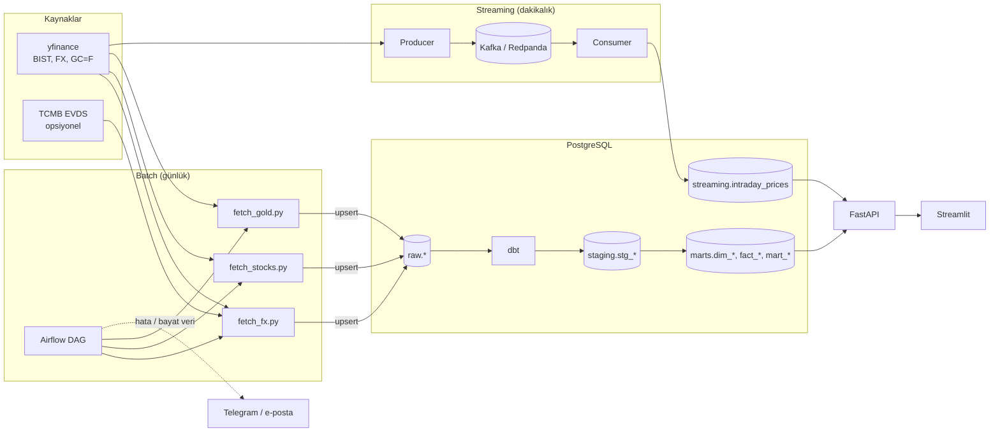

# Mimari (taslak)

## Katmanlar

| Şema | İçerik | Sahibi |
|---|---|---|
| `raw` | Kaynaktan geldiği gibi, `(sembol, tarih)` üzerinde upsert | Python çekiciler |
| `staging` | Temizlenmiş, tipleri düzeltilmiş `stg_*` görünümleri | dbt |
| `marts` | Star schema + göstergeler, korelasyonlar | dbt |
| `streaming` | Dakikalık fiyatlar ve pencere ortalamaları | Kafka consumer |
| `ops` | Pipeline çalışma kayıtları, sağlık durumu | Airflow |
