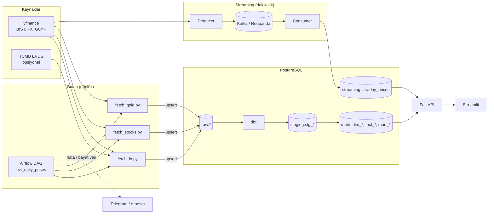

# Mimari (taslak)

## Katmanlar

| Şema | İçerik | Sahibi |
|---|---|---|
| `raw` | Kaynaktan geldiği gibi; doğal anahtar `(enstrüman, tarih, kaynak)` üzerinde idempotent upsert (`bvt.raw_loader`) | Python çekiciler |
| `staging` | Temizlenmiş, tipleri düzeltilmiş `stg_*` görünümleri | dbt |
| `marts` | Star schema + göstergeler, korelasyonlar | dbt |
| `streaming` | Dakikalık fiyatlar ve pencere ortalamaları | Kafka consumer |
| `ops` | Pipeline çalışma kayıtları, sağlık durumu | Airflow |

## Orkestrasyon (Airflow)

- **Servisler:** `airflow-webserver` (:8080), `airflow-scheduler`, tek seferlik `airflow-init`; LocalExecutor.
  Airflow metadata'sı ayrı bir PostgreSQL'de (`airflow-db`) tutulur, proje verisi (`postgres`) ile karışmaz.
- **Kod:** `src/` ve `sql/` konteynere salt-okunur bağlanır (`PYTHONPATH=/opt/bvt/src`); imaj yalnızca
  bağımlılıkları içerir, kod değişikliği için yeniden derleme gerekmez.
- **DAG `bvt_daily_prices`:** Pzt-Cum 19:30 İstanbul, `catchup=False`, `max_active_runs=1`. Üç bağımsız
  `PythonOperator` görevi `bvt.pipeline.run_daily(kaynak, data_interval_end)` çağırır. Pencere: son
  `BVT_LOOKBACK_DAYS` gün (idempotent yeniden çekim). Görev özeti (kaynak, pencere, satır sayısı) XCom'a,
  ayrıntılı sayımlar `ops.pipeline_runs`'a yazılır.
- DAG dosyası projeden üst düzeyde yalnızca `bvt.pipeline`ı içe aktarır (o da yalnızca standart kütüphane kullanır; scheduler ayrıştırması hızlı kalır);
  pandas/yfinance görev çalışırken yüklenir.
